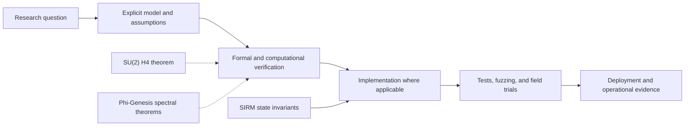

# UltraCore-RFT — System and Research Architecture

> **Status snapshot: 9 November 2026.** This is an evidence map of distinct research and engineering tracks. It does not claim that they form one mathematical theory.

## 1. Purpose

UltraCore-RFT is the documentation and integration hub for the RFT-SIRM research programme. It brings together formal mathematical results, higher-moment work, systems engineering, and exploratory applications while preserving the evidence boundary of each.

The architecture has four tracks:

1. **SU(2) graph operators:** a non-commuting connection on finite Sierpiński-gasket graphs, a commuting control, and an all-level fourth-moment trace-defect theorem.
2. **Signed $Z_2$-flux graph spectra:** the separate Phi-Genesis graph-Laplacian model, including a uniform lower bound and least-eigenvalue convergence for levels $N\ge6$.
3. **Higher moments:** H⁶, H⁸, and H¹⁰ results with distinct theorem and finite-certificate boundaries.
4. **SIRM engineering:** runtime invariants, state-transition constraints, deterministic execution, testing, and application prototypes.

**The SU(2) connection operators and the signed $Z_2$-flux matrices are different operator families. No equivalence between them is claimed.** A theorem in either family does not, by itself, prove an engineering invariant, a physical law, or an application-level performance claim.

## 2. Evidence principles

- Define the graph, operator, boundary conditions, and quantifiers before stating a result.
- Distinguish Lean theorems, exact finite certificates, numerical computations, tests, and exploratory models.
- State the level range explicitly: an all-level theorem is not interchangeable with a result for $N\ge6$.
- Keep open problems visible; numerical agreement does not close a proof obligation.
- Treat the transfer from mathematical results to physical interpretation or engineering deployment as a separate argument.

## 3. Research-to-implementation path

The mathematical projects supply separate formal evidence. The engineering path follows a similar discipline of explicit assumptions and reproducible checks, but the diagram does not imply that the mathematical theorems are dependencies of the runtime or network software.

## 4. Artifact map

| Layer | Primary source | Established result | Boundary |
|---|---|---|---|
| SU(2) mathematics | [Evgeny's Theorem](https://github.com/RFT-SIRM/Evgeny-Theorem) | Exact H⁴ trace-defect identity for the specified connection and commuting control | Lean theorem for every $m\ge1$ and real (	heta); semantic review remains separate |
| Higher moments | [Higher-moment status](https://github.com/RFT-SIRM/Evgeny-Theorem/blob/main/docs/HIGHER_MOMENTS.md) | H⁶/H⁸ recurrences and H¹⁰ affine recurrence | H⁶/H⁸ finite $m=2\to3$ bridges are exact certificates, not yet Lean-kernel theorems |
| Signed graph spectra | [Phi-Genesis](https://github.com/RFT-SIRM/Phi-Genesis) | Signed-Laplacian lower bound $\lambda\ge1$; least-eigenvalue convergence for $N\ge6$ | Gate A, quadratic law, closed form, and external operator identification remain open |
| SIRM model | [Development strategy](RFT_DEVELOPMENT_STRATEGY.md) | Runtime invariants and state-transition constraints | Engineering specification and project-specific test evidence |
| Runtime and network | [Rift Network](https://github.com/RFT-SIRM/Rift-Network), [Agave scheduler](https://github.com/RFT-SIRM/agave-rift-scheduler) | Runtime, memory-context, scheduler, and economic-interface implementations | Benchmarks, audits, and fuzz results apply only to their stated revisions and configurations |

## 5. SU(2) fourth-moment theorem

Let (SG(m)) be the level-(m) Sierpiński-gasket approximation graph. Its vertex count is

$$
|V_m|=\frac{3^{m+1}+3}{2}.
$$

The Hilbert space is (mathbb{C}^{|V_m|}\otimes\mathbb{C}^{2}), so the operator dimension is (3^{m+1}+3). Each edge carries an (SU(2))-valued unitary connection. The non-commuting configuration (C) cycles its rotation axis through (x,y,z); the commuting control (C') fixes the axis to (z).

For the operator definitions in [Evgeny's Theorem](https://github.com/RFT-SIRM/Evgeny-Theorem/blob/main/THEOREM.md), Lean 4 proves for every $m\ge1$ and real (	heta):

$$
\Delta_m(H^4,\theta)
=\mathrm{Tr}(H_C^4)-\mathrm{Tr}(H_{C'}^4)
=-16(3^{m-1}+1)\sin^2\left(\frac{\theta}{2}\right).
$$

The normalized trace defect satisfies

$$
I_m(\theta)=\frac{\Delta_m(H^4,\theta)}{3^{m+1}+3}
\longrightarrow -\frac{16}{9}\sin^2\left(\frac{\theta}{2}\right),
\qquad I_\infty\left(\frac{\pi}{2}\right)=-\frac89.
$$

The closed formula gives constant arithmetic work for this scalar quantity. It does not make full matrix construction, eigensystem computation, circuit implementation, or other moments constant-time. The theorem's relationship to SIRM is methodological; no derivation from this identity to the SIRM invariants is claimed.

## 6. Phi-Genesis signed-flux spectral results

Phi-Genesis studies a separate family of signed $Z_2$-flux graph Laplacians and their gauge relation to signless graph Laplacians.

For the explicitly defined signed Laplacian, Lean proves that every real eigenvalue represented by a nonzero real eigenvector satisfies

$$
\lambda\ge1
$$

at every refinement level.

For the signless graph Laplacians $Q_{6+n}$ and their diagonally gauge-conjugate signed matrices, the least eigenvalues converge to a common limit, denoted by $\lambda_\infty$. The exact rational enclosure is

$$
\frac{1309128920280813421888623088170810187}{10^{36}}
\le\lambda_\infty\le
\frac{1309128920280813421888623088170810189}{10^{36}}.
$$

In decimal notation, the same enclosure is

$$
1.309128920280813421888623088170810187
\le\lambda_\infty\le
1.309128920280813421888623088170810189.
$$

The endpoints differ by exactly $2\cdot10^{-36}$. The midpoint is approximately $1.309128920280813421888623088170810188$. This is the limiting least eigenvalue of the specified graph-matrix sequence, not a known closed-form value or a claimed universal physical constant. The convergence theorem covers levels $N\ge6$.

**Derivative recursion.** [SchurDerivTrajectory.lean](https://github.com/RFT-SIRM/Phi-Genesis/blob/main/PhiGenesis/SpectralGap/SchurDerivTrajectory.lean) defines the exact parameter-derivative recursion for the two Schur boundary coordinates and proves their differentiability at each finite level in the bootstrap window. The nonzero-pivot hypotheses follow from the previously proved strict pivot positivity. This is an analytic ingredient for further asymptotics; it does not prove the quadratic increment law.

**Still open:** the quadratic increment law $\delta_{m+1}\sim c\delta_m^2$ and existence of $c$; the wider Gate A exceptional-set characterization; a closed form for $\lambda_\infty$; extension to levels $N<6$; and identification with an external $\theta=2\pi$ operator. No bridge to the SU(2) operator family is claimed.

Formal sources: [least-eigenvalue theorem](https://github.com/RFT-SIRM/Phi-Genesis/blob/main/PhiGenesis/SpectralGap/SchurEigenvalue.lean) · [signed transfer](https://github.com/RFT-SIRM/Phi-Genesis/blob/main/PhiGenesis/SpectralGap/SchurSignedTransfer.lean) · [derivative recursion](https://github.com/RFT-SIRM/Phi-Genesis/blob/main/PhiGenesis/SpectralGap/SchurDerivTrajectory.lean) · [proof map](https://github.com/RFT-SIRM/Phi-Genesis/blob/main/computational/spectral_gap_theta_2pi/PROOF_MAP.md).

## 7. SIRM engineering layer

SIRM defines runtime invariants for state transitions:

$$
\begin{aligned}
I_1:\quad & S=B+Gp,\\
I_2:\quad & S=M-D,\\
I_3:\quad & d
0),\\
I_4:\quad & E_i\ge-\frac{S}{10p}.
\end{aligned}
$$

The effective-balance relation is

$$
E_i=b_i+G.
$$

These are engineering specifications enforced and tested at the implementation layer. They are not consequences of either graph-operator theorem. Runtime, scheduler, memory isolation, and economic-interface components retain their own validation criteria and evidence.

## 8. Current status

- **SU(2) H⁴:** machine-checked in Lean 4 for all $m\ge1$ and real (	heta), for the formalized operators.
- **H⁶/H⁸:** Lean recurrences for $m\ge3$; exact finite $m=2\to3$ certificates remain to be formalized in Lean.
- **H¹⁰:** unconditional affine recurrence for $m\ge4$, with affine form for $m\ge5$.
- **Phi-Genesis:** signed-Laplacian lower bound at every level; least-eigenvalue convergence for $N\ge6$; derivative recursion in the bootstrap window.
- **SIRM and runtime:** separate engineering workstreams with their own tests, fuzzing, audits, and operational evidence.

## 9. Review documents

- [Focused SU(2) dissertation](docs/DISSERTATION.md)
- [Research monographs](docs/monographs.md)
- [AI evidence guide](AI_GUIDE.md)
- [Research map](docs/research-map.md)
- [Scientific basis and claim boundaries](SCIENTIFIC_BASIS.md)
- [Historical development record](docs/history.md)
- [Phi-Genesis formalization](https://github.com/RFT-SIRM/Phi-Genesis)

---

*Copyright 2026 Eugeny (RFT-SIRM). License: Apache 2.0.*
