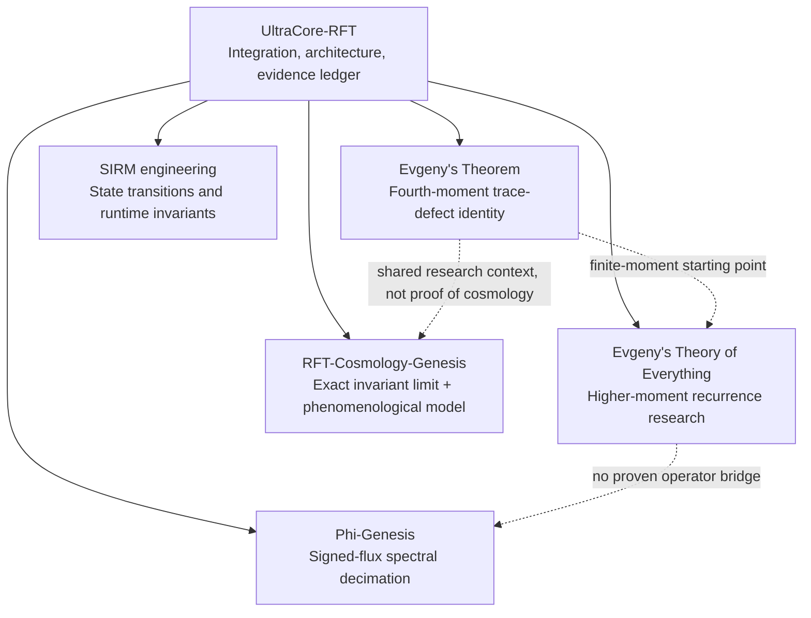
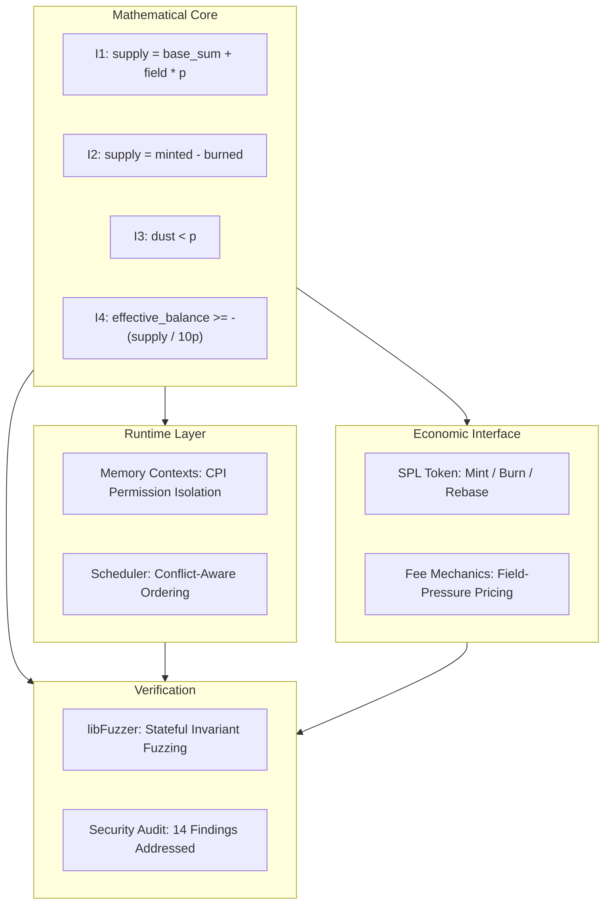
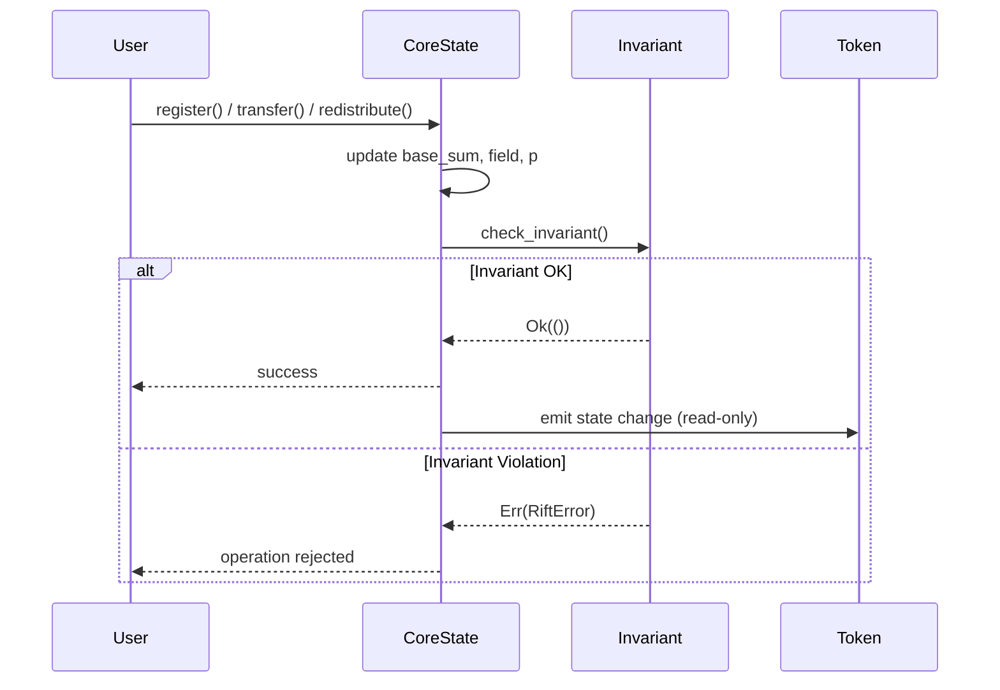
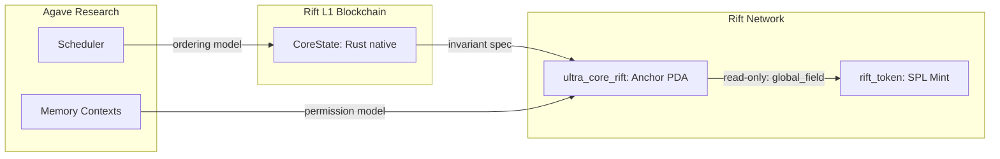

# Architecture

## Design Philosophy

RFT-SIRM separates research claims, mathematical definitions, executable implementations, and verification evidence. Engineering components should enforce their specified invariants and reject invalid state transitions atomically where the implementation supports that guarantee. Guarantees are scoped to the relevant code, threat model, and tests; documentation must not imply that every component or research result is formally verified.

## Research Architecture: Four Distinct Evidence Tracks

UltraCore-RFT is the integration and navigation layer for a portfolio of related research and engineering projects. It connects the projects without treating their results as interchangeable. Each source repository remains authoritative for its theorem statements, definitions, code, tests, formal proof status, and limitations.



The dashed links indicate research context only; they do not imply a proved mathematical equivalence or causal derivation.

### 1. Evgeny's Theorem: a formalized fourth-moment result

**Primary sources:** [source repository](https://github.com/RFT-SIRM/Evgeny-Theorem), [theorem statement](https://github.com/RFT-SIRM/Evgeny-Theorem/blob/main/THEOREM.md), [Lean formalization](https://github.com/RFT-SIRM/Evgeny-Theorem/tree/main/formalization), and [verification record](https://github.com/RFT-SIRM/Evgeny-Theorem/blob/main/VERIFICATION.md).

For the specific operator definitions and assumptions in that project, the stated identity is

$
\Delta_m(H^4,\theta)
=\mathrm{Tr}(H_C^4)-\mathrm{Tr}(H_{C'}^4)
=-16(3^{m-1}+1)\sin^2\left(\frac{\theta}{2}\right),
\qquad m\geq1.
$

The source project reports a Lean 4 formalization. The scope of that formalization is the encoded proposition and its definitions. It does not, by itself, prove the higher-moment recurrence, the signed-flux decimation criterion, SIRM runtime invariants, or a physical interpretation.

### 2. Evgeny's Theory of Everything: higher-moment recurrence programme

**Primary sources:** [repository](https://github.com/RFT-SIRM/Evgeny-s-Theory-of-Everything), [dissertation](https://github.com/RFT-SIRM/Evgeny-s-Theory-of-Everything/blob/main/DISSERTATION.md), [final status](https://github.com/RFT-SIRM/Evgeny-s-Theory-of-Everything/blob/main/FINAL_STATUS.md), and [claims and evidence](https://github.com/RFT-SIRM/Evgeny-s-Theory-of-Everything/blob/main/CLAIMS_AND_EVIDENCE.md).

This programme studies trace defects for higher even moments \(H^6\), \(H^8\), and \(H^{10}\), including Fourier-coefficient candidates, exact finite-level modular/CRT certificates, and independent sparse-matrix numerical holdouts. The repository reports checks through level 7 for specified finite sets of angles and a pinned Lean build for the upstream fourth-moment result. These are distinct evidence types. The universal all-level higher-moment recurrence remains **open**: finite certificates and numerical agreement do not establish it.

### 3. Phi-Genesis: signed-flux spectral analysis

**Primary sources:** [repository](https://github.com/RFT-SIRM/Phi-Genesis), [verified results](https://github.com/RFT-SIRM/Phi-Genesis/blob/main/docs/verified-results.md), [research map](https://rft-sirm.github.io/Phi-Genesis/research-map.html), and [reproducibility guide](https://rft-sirm.github.io/Phi-Genesis/reproducibility.html).

Phi-Genesis investigates signed \(\mathbb{Z}_2\)-flux graph Laplacians on Sierpiński-gasket approximations, spectral decimation, spectral gaps, boundary/corner corrections, inertia-based counting, and exploratory integer mass-index patterns. The factor-5 decimation structure is reported with boundary/corner qualifications. **Gate A remains open** because the full exceptional set and all residual mismatches have not been explained. The proposed index set \(\{1,12,17,40\}\) is not established as a predictive selection law. The signed-flux operators are not assumed equivalent to the SU(2)-connected operators in Evgeny's Theorem.

### 4. RFT-Cosmology-Genesis: exact invariant and phenomenological extension

**Primary sources:** [repository](https://github.com/RFT-SIRM/RFT-Cosmology-Genesis), [exact invariant remainder theorem](https://github.com/RFT-SIRM/RFT-Cosmology-Genesis/blob/main/EXACT_INVARIANT_REMAINDER_THEOREM.md), [model specification](https://github.com/RFT-SIRM/RFT-Cosmology-Genesis/blob/main/MODEL_SPEC.md), [results](https://github.com/RFT-SIRM/RFT-Cosmology-Genesis/blob/main/RESULTS.md), and [limitations](https://github.com/RFT-SIRM/RFT-Cosmology-Genesis/blob/main/LIMITATIONS.md).

For the normalized invariant defined in that repository,

$
I_m(\theta)=-16\frac{3^{m-1}+1}{3^{m+1}+3}\sin^2\left(\frac{\theta}{2}\right),
$

the exact limit and finite-level remainder are

$
I_\infty(\theta)=-\frac{16}{9}\sin^2\left(\frac{\theta}{2}\right),
\qquad
I_m(\theta)-I_\infty(\theta)
=-\frac{32}{9(3^m+1)}\sin^2\left(\frac{\theta}{2}\right).
$

The repository records an algebraic derivation and Lean-checked results for the stated invariant. Its photon-sector coupling and background/CMB response are **phenomenological**. No physical origin for the coupling, detection of a new interaction, or agreement with a full observational CMB likelihood is established by this mathematical identity.

### 5. SIRM engineering architecture

SIRM is the Synthetic Intelligence Reasoning Model. In the engineering repositories, the operational core is a state-transition model constrained by explicit invariants, arithmetic checks, permission boundaries, and reproducible tests. These implementation-level constraints must be documented and verified against the actual code. They are not consequences of the spectral trace identity unless a separate formal connection is stated and proved.

## Evidence and Dependency Rules

| Evidence class | What it supports | What it does not establish by itself |
|---|---|---|
| Machine-checked theorem | The encoded statement under its definitions, assumptions, and build | Unencoded generalizations or physical interpretation |
| Exact finite-level certificate | The stated finite coefficient/identity claims in its certified scope | An all-level recurrence |
| Reproducible numerical holdout | The tested finite instances, parameters, and algorithms | A universal theorem or causal explanation |
| Spectral computation | Properties observed for the stated graph/operator convention and level | A particle-mass law or cosmological mechanism |
| Phenomenological fit/model | Behaviour under the stated model and parameter choices | Physical validation or observational discovery |
| Runtime tests/fuzzing | Executed code paths and checked invariants under test conditions | Absence of all bugs or formal correctness |

Cross-project dependencies must be explicit and versioned. Do not transfer a proof or verification label from one repository to another. In particular, the fourth-moment result does not close the higher-moment recurrence, Phi-Genesis Gate A, or the physical cosmology programme.

---

## System Overview



## Component Map

| Component | Repository | Language | Responsibility |
|-----------|-----------|----------|----------------|
| CoreState | [Rift-L1-Blockchain](https://github.com/RFT-SIRM/Rift-L1-Blockchain) | Rust | O(1) distribution, invariant enforcement, fuzz verification |
| ultra_core_rift | [Rift-Network](https://github.com/RFT-SIRM/Rift-Network) | Rust/Anchor | On-chain SIRM invariant program |
| rift_token | [Rift-Network](https://github.com/RFT-SIRM/Rift-Network) | Rust/Anchor | SPL token interface, read-only access to CoreState |
| Memory Contexts | [agave-abiv2-memory-contexts](https://github.com/RFT-SIRM/agave-abiv2-memory-contexts) | Rust | Per-CPI-frame writable permission isolation (PoC research) |
| Scheduler | [agave-rift-scheduler](https://github.com/RFT-SIRM/agave-rift-scheduler) | Rust | Conflict-aware transaction scheduling with bounded retries |

## Invariant Enforcement Flow



## Separation of Concerns

### CoreState (Math Layer)
- Owns `global_field`, `total_base_sum`, `total_supply`
- Enforces I1-I4 after every operation
- Does not interact with SPL token accounts

### RiftToken (Economic Layer)
- Reads `CoreState` to compute `rift_multiplier`
- Issues SPL tokens via CPI to `token::mint_to`
- Never writes to `CoreState`

### Memory Contexts (Runtime Layer)
- Tracks per-CPI-frame writable permissions (PoC research)
- Ensures rollback on `pop()` (snapshot-based prototype; upstream `feat/abiv2` uses `abi_v2_prepare_for_instruction` + `make_immutable`)
- Independent of economic logic

### Scheduler (Runtime Layer)
- Orders transactions by conflict heat score
- Guarantees bounded retries (no silent loss)
- Independent of economic logic

## Cross-Repository Data Flow



## O(1) Distribution

Standard approach (Ethereum, most L1s):
```
for each participant:
 balance[i] += reward / N -- O(N) gas, O(N) time
```

RFT approach:
```
global_field += reward / p -- O(1), one integer, all participants
```

At 1,000,000 participants:
- Standard: 1,000,000 storage writes per distribution
- Rift: 1 write

This is a different mathematical model, not an optimization.

## Security Model

| Layer | Guarantee | Mechanism |
|-------|-----------|-----------|
| Arithmetic | No overflow/underflow | `checked_add`, `checked_sub`, `checked_mul`, `try_into()` |
| State | Atomic operations | Full success or `Err` -- no partial writes |
| Access | Authority validation | PDA seeds, `has_one`, `Signer` constraints |
| Runtime | Memory isolation | Per-frame permission snapshots, rollback on `pop()` (PoC research; upstream `feat/abiv2` uses `abi_v2_prepare_for_instruction` + `make_immutable`) |
| Scheduling | No silent loss | Bounded retry count, explicit drain passes |
| Economics | Supply integrity | `check_invariant()` after every mutation |

---

See also: [Foundations](foundations.md) for mathematical derivations, [Implementation](implementation.md) for code-level details.
