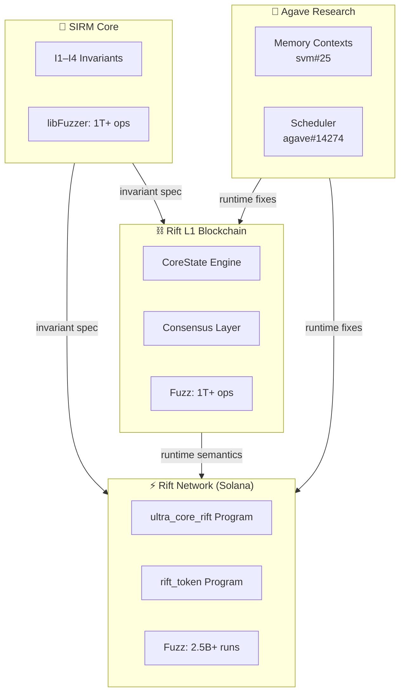

# Implementation

> **Scope:** Technical implementation details, component architecture, upstream contributions, and build instructions for the RFT-SIRM ecosystem.

---

## 1. Architecture Overview

The RFT-SIRM ecosystem brings together **Resonant Field Theory (RFT)**, the **Synthetic Intelligence Reasoning Model (SIRM)**, formal mathematics, reproducible computation, and engineering applications. RFT names the theory; SIRM names the reasoning and invariant-based systems model. The projects below are related research tracks, not claims that every application follows mathematically from every theorem.



**Design principle:** Every component shares the same four hard invariants (I1–I4). Fuzzing targets are derived directly from the invariant specification, not from implementation assumptions.

---

## 2. Research programme: results, scope, and evidence

UltraCore-RFT is the integration and navigation layer for the research programme. Primary repositories remain authoritative for their own definitions, code, proofs, test results, and status. The following tracks must be assessed independently.

### 2.1 Evgeny's Theorem — fourth-moment trace-defect identity

**Primary source:** [Evgeny-Theorem](https://github.com/RFT-SIRM/Evgeny-Theorem) · [Theorem statement](https://github.com/RFT-SIRM/Evgeny-Theorem/blob/main/THEOREM.md) · [Lean formalization](https://github.com/RFT-SIRM/Evgeny-Theorem/tree/main/formalization) · [Verification record](https://github.com/RFT-SIRM/Evgeny-Theorem/blob/main/VERIFICATION.md).

For the concrete operator definitions and assumptions in the source project, the fourth-moment trace defect is stated as

$$
\Delta_m(H^4,\theta)
=\mathrm{Tr}(H_C^4)-\mathrm{Tr}(H_{C'}^4)
=-16(3^{m-1}+1)\sin^2\left(\frac{\theta}{2}\right),
\qquad m\geq1.
$$

The source repository reports a Lean 4 formalization. This status applies to that specific proposition and its formal definitions; it does not prove the higher-moment recurrence, the Phi-Genesis decimation criterion, SIRM runtime invariants, or a cosmological interpretation.

### 2.2 Evgeny's Theory of Everything — higher moments and synthesis

**Primary source:** [Evgeny's Theory of Everything](https://github.com/RFT-SIRM/Evgeny-s-Theory-of-Everything) · [Dissertation](https://github.com/RFT-SIRM/Evgeny-s-Theory-of-Everything/blob/main/DISSERTATION.md) · [Final status](https://github.com/RFT-SIRM/Evgeny-s-Theory-of-Everything/blob/main/FINAL_STATUS.md) · [Claims and evidence ledger](https://github.com/RFT-SIRM/Evgeny-s-Theory-of-Everything/blob/main/CLAIMS_AND_EVIDENCE.md).

This synthesis track investigates recursive graph operators, Fourier coefficients, residuals, and candidate recurrence relations for moments \(H^6\), \(H^8\), and \(H^{10}\). Exact modular/CRT certificates cover specified finite-level coefficient claims, and independent sparse-matrix calculations provide finite numerical holdouts. The all-level recurrence remains **open**; finite certificates and numerical agreement must not be presented as an all-level proof.

### 2.3 Phi-Genesis — signed-flux spectral research

**Primary source:** [Phi-Genesis](https://github.com/RFT-SIRM/Phi-Genesis) · [Research map](https://rft-sirm.github.io/Phi-Genesis/research-map.html) · [Verified results](https://rft-sirm.github.io/Phi-Genesis/verified-results.html) · [Reproducibility guide](https://rft-sirm.github.io/Phi-Genesis/reproducibility.html).

Phi-Genesis studies signed \(\mathbb{Z}_2\)-flux Laplacians on Sierpiński-gasket graph approximations, spectral decimation, spectral gaps, boundary/corner corrections, inertia, and candidate integer mass-index patterns. The factor-5 decimation structure is reported with boundary/corner qualifications. **Gate A remains open:** the full exceptional set and residual mismatches are not completely characterized. The proposed index set \(\{1,12,17,40\}\) has not been established as a predictive selection law. This operator family is distinct from the SU(2)-connected operators in Evgeny's Theorem unless and until a precise bridge is proved.

### 2.4 RFT-Cosmology-Genesis — exact invariant limit and phenomenological model

**Primary source:** [RFT-Cosmology-Genesis](https://github.com/RFT-SIRM/RFT-Cosmology-Genesis) · [Exact Invariant Remainder Theorem](https://github.com/RFT-SIRM/RFT-Cosmology-Genesis/blob/main/EXACT_INVARIANT_REMAINDER_THEOREM.md) · [Model specification](https://github.com/RFT-SIRM/RFT-Cosmology-Genesis/blob/main/MODEL_SPEC.md) · [Results](https://github.com/RFT-SIRM/RFT-Cosmology-Genesis/blob/main/RESULTS.md) · [Limitations](https://github.com/RFT-SIRM/RFT-Cosmology-Genesis/blob/main/LIMITATIONS.md).

For the repository's defined normalized invariant,

$$
I_m(\theta)=-16\frac{3^{m-1}+1}{3^{m+1}+3}
\sin^2\left(\frac{\theta}{2}\right),
$$

the exact algebraic limit and finite-level remainder are

$$
I_\infty(\theta)=-\frac{16}{9}\sin^2\left(\frac{\theta}{2}\right),
\qquad
I_m(\theta)-I_\infty(\theta)
=-\frac{32}{9(3^m+1)}\sin^2\left(\frac{\theta}{2}\right).
$$

The repository documents an algebraic derivation and Lean-checked results for the stated invariant, with Python tests for representative cases. Its cosmological coupling and CMB response are **phenomenological**. No physical interaction, observational detection, or agreement with a full CMB likelihood is established.

### 2.5 SIRM engineering model and runtime invariants

SIRM specifies deterministic state transitions through implementation-level invariants. These constraints are separate from the spectral trace theorem. Their validity and performance must be supported by the relevant source code, tests, fuzzing configuration, and reports; they must not be inferred from the mathematical theorem.

### Cross-project evidence boundary

| Track | What is supported | What remains open or is not implied |
|---|---|---|
| Evgeny's Theorem | A specified fourth-moment identity reported as Lean-formalized | Independent semantic review, literature novelty, and any broader theorem |
| Theory-of-Everything synthesis | Finite coefficient certificates and numerical holdouts for stated cases | All-level higher-moment recurrence |
| Phi-Genesis | Reproducible finite-level spectral observations with stated corrections | Complete Gate A closure and a predictive mass-index law |
| RFT-Cosmology-Genesis | Exact algebraic limit/remainder for the defined invariant; reduced model calculations | Physical origin of the coupling and observational cosmology validation |
| SIRM engineering | Runtime invariant specification and implementation-specific test evidence | Formal proof or production readiness unless supported by separate evidence |

Do not transfer evidence status between tracks. A result in one repository does not automatically prove a claim in another.

---

## 3. SIRM Core: The Mathematical Foundation

All RFT-SIRM systems are instances of a single deterministic state machine:

```
State  = (total_supply, total_base_sum, global_field, p, dust_accumulator, base_balance[])

I1: total_supply = total_base_sum + global_field * p
I2: total_supply = total_minted - total_burned
I3: dust_accumulator < p  (when p > 0)
I4: effective_balance[i] >= -(total_supply / 10p)

where effective_balance[i] = base_balance[i] + global_field
```

**Key property:** `global_field` is a scalar. Updating it by `Δ` changes every participant's effective balance by `Δ` simultaneously — **O(1)** regardless of participant count. No iteration. No per-account writes. Deterministic and verifiable.

---

## 4. Component Breakdown

### 3.1 Rift L1 Blockchain

| Property | Value |
|:---------|:------|
| **Role** | Standalone validator core with SIRM-native consensus |
| **Language** | Rust 1.75+ |
| **Status** | Core complete |
| **Repository** | [RFT-SIRM/Rift-L1-Blockchain](https://github.com/RFT-SIRM/Rift-L1-Blockchain) |
| **Verification** | libFuzzer, 1T+ operations, 0 invariant violations |
| **Key Feature** | `CoreState` engine enforces I1–I4 at every block boundary |

The L1 blockchain is the reference implementation of SIRM in a standalone consensus environment. It validates that the invariant model can sustain a production-grade validator without architectural compromises.

### 3.2 Rift Network (Solana)

| Property | Value |
|:---------|:------|
| **Role** | Solana on-chain protocol implementing SIRM via Anchor |
| **Language** | Rust / Anchor 0.29+ |
| **Status** | RC v1.0 |
| **Repository** | [RFT-SIRM/Rift-Network](https://github.com/RFT-SIRM/Rift-Network) |
| **Verification** | 2.5B+ fuzz runs, 14 security audit findings addressed |
| **Key Feature** | `ultra_core_rift` program enforces I1–I4 in Solana runtime |

Rift Network brings SIRM invariants to the Solana ecosystem. It demonstrates that the same mathematical core can operate within the constraints of an existing L1 runtime without relaxing deterministic guarantees.

### 3.3 Agave Memory Contexts

| Property | Value |
|:---------|:------|
| **Role** | SVM memory isolation and CPI security research |
| **Language** | Rust |
| **Status** | Active research — bug reported upstream |
| **Repository** | [RFT-SIRM/agave-abiv2-memory-contexts](https://github.com/RFT-SIRM/agave-abiv2-memory-contexts) |
| **Upstream** | [anza-xyz/svm#25](https://github.com/anza-xyz/svm/issues/25) |
| **Key Finding** | CPI permission leakage: per-frame writable permission rollback failure |

**Problem:** During CPI execution in Agave SVM, multiple `update_account_permissions` calls within a single frame destroyed rollback entries from earlier calls. On `pop()`, only the last-touched account was restored; earlier accounts retained modified permissions permanently.

**Impact:** Writable permissions could leak across CPI boundaries, violating isolation guarantees.

**Fix:** Record each account's pre-frame value only on its first touch within the frame, never overwriting on subsequent calls.

### 3.4 Agave Scheduler

| Property | Value |
|:---------|:------|
| **Role** | Conflict-aware transaction scheduling research |
| **Language** | Rust |
| **Status** | RFC published — upstream discussion open |
| **Repository** | [RFT-SIRM/agave-rift-scheduler](https://github.com/RFT-SIRM/agave-rift-scheduler) |
| **Upstream** | [anza-xyz/agave#14274](https://github.com/anza-xyz/agave/issues/14274) |
| **Key Finding** | GreedyScheduler deferred queue lacks retry bound and starvation observability |

**Observation:** `GreedyScheduler` in Agave defers conflicting transactions by re-inserting them into the priority queue without a per-transaction retry counter, a configurable upper bound, or a `dropped_transactions` metric.

**Impact:** Under sustained write contention on a hot account, lower-priority transactions may be deferred indefinitely. They are not lost from the queue, but their scheduling latency is unbounded and unobservable.

**Proposal:** Add `max_retry_count` (configurable) and `dropped_transactions` metric to `GreedySchedulerConfig` / `SchedulingSummary`. ~15 lines. No policy change.

**Verification:** Rift Scheduler reference implementation enforces bounded retry semantics with I1–I4 invariants. 91M+ fuzz executions, 0 violations.

---

## 5. Upstream Contributions

Security research and runtime improvements developed within the RFT-SIRM ecosystem are reported back to the Solana core infrastructure.

| Issue | Component | Type | Description | Status |
|:------|:----------|:-----|:------------|:-------|
| [anza-xyz/svm#25](https://github.com/anza-xyz/svm/issues/25) | SVM Runtime | Security | CPI permission leakage: per-frame writable permission rollback failure when multiple `update_account_permissions` calls occur within a single CPI frame. | Reported, awaiting review |
| [anza-xyz/agave#14274](https://github.com/anza-xyz/agave/issues/14274) | Banking Stage | RFC | Bounded retry semantics and starvation observability for GreedyScheduler: documented scheduling limitation, proposed `max_retry_count` and `dropped_transactions` metric. | RFC open, discussion active |

---

## 6. Repository Alignment

| UltraCore-RFT | Rift-Network | Rift-L1-Blockchain | agave-abiv2-memory-contexts | agave-rift-scheduler |
|:--------------|:-------------|:-------------------|:----------------------------|:---------------------|
| `main` | `v1.0-RC` | `main` | `main` | `main` |

All repositories track `main` as the primary branch. Version tags are synchronized on milestone boundaries.

---

## 7. Build and Test

### 6.1 Rift L1 Blockchain

```bash
cd Rift-L1-Blockchain
cargo build --release
cargo test --lib
cargo test --test '*'
./run_5hour_test.sh
```

### 6.2 Rift Network

```bash
cd Rift-Network
anchor build
anchor test
```

### 6.3 Agave Memory Contexts

```bash
cd agave-abiv2-memory-contexts
cargo test
cargo +nightly fuzz run fuzz_target_1 -- -max_total_time=300
```

### 6.4 Agave Scheduler

```bash
cd agave-rift-scheduler
cargo test --lib
cargo +nightly fuzz run scheduler_fuzz -- -max_total_time=300
```

---

## 8. Technology Stack

| Layer | Technology | Version | Purpose |
|:------|:-----------|:--------|:--------|
| Core Implementation | Rust | 1.75+ | Deterministic state engine |
| Smart Contracts | Anchor / Solana | 0.29+ | On-chain protocol |
| Fuzzing | libFuzzer + cargo-fuzz | nightly | Invariant verification |
| Documentation | MkDocs Material | 9.5+ | Research documentation |
| CI/CD | GitHub Actions | ubuntu-latest | Continuous verification |

---

## 9. Engineering Roadmap

| Phase | Component | Target | Deliverable |
|:------|:----------|:-------|:------------|
| ✅ Complete | SIRM Core Invariants | Mathematical stability | Formal specification, fuzz-verified |
| ✅ Complete | Rift L1 Blockchain | Consensus-ready architecture | Standalone validator, 1T+ ops fuzzed |
| 🔄 RC v1.0 | Rift Network | Production candidate | Anchor protocol, security audit |
| 🔬 Active | Agave Memory Contexts | Runtime security | Upstream bug report (svm#25) |
| 📋 Published | Agave Scheduler | Scheduling observability | RFC (agave#14274), reference implementation |
| 📅 Planned | Formal Verification | Machine-checked proofs | TLA+ / Coq specifications |
| 📅 Planned | Side-by-side Benchmark | Real-world validation | `scheduler-bindings` testnet deployment |

**Legend:** ✅ Complete · 🔄 Release Candidate · 🔬 Active Research · 📋 RFC Published · 📅 Planned

---

## 10. Cross-References

- [Architecture](architecture.md) — System architecture and design decisions
- [Field Trials](field_trials.md) — Verification results and readiness checklist
- [Foundations](foundations.md) — Mathematical foundations of SIRM
- [Strategy](strategy.md) — Development roadmap and research phases
- [Glossary](glossary.md) — Terminology and definitions
