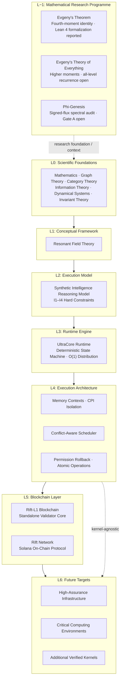
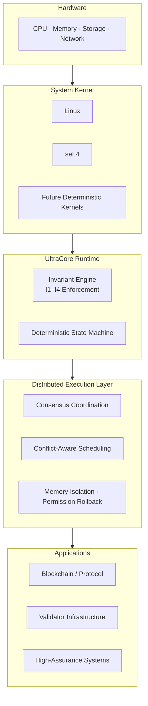

# Research Programme and Execution Platform

> **Strategic identity document.**
>
> UltraCore-RFT is the coordination hub for a research programme whose public scientific narrative starts with **mathematical definitions and evidence**: [Evgeny's Theory of Everything](https://github.com/RFT-SIRM/Evgeny-s-Theory-of-Everything), the [Lean-formalized fourth-moment theorem](https://github.com/RFT-SIRM/Evgeny-Theorem/tree/main/formalization), and the separate [Phi-Genesis spectral audit](https://github.com/RFT-SIRM/Phi-Genesis). The theorem is specific; the broader programme is not claimed to be a completed physical Theory of Everything.
>
> The programme then branches into invariant-based systems engineering and applications. UltraCore's engineering identity remains a deterministic execution architecture—not because the blockchain is the foundation, but because the runtime work is one downstream implementation strand. See the [research map](research-map.md) and [historical development](history.md).

* * *

## 1. The Transition

The ecosystem contains two connected but distinct kinds of work: literal mathematical research and systems engineering. The mathematical strand includes a specific fourth-moment identity reported as machine-checked in Lean 4, higher-moment extensions that remain open at the all-level stage, and a separate signed-flux spectral-decimation audit. The systems strand applies invariant-first design to deterministic state transitions, runtimes, protocols, and verification.

The correct hierarchy is therefore not “blockchain first.” It is **definitions and theorem → evidence and open questions → engineering methodology → implementations and exploratory applications**. The arrows express a reading order and research motivation, not a claim that the theorem proves the applications.

This document explains the execution-platform strand within that larger research programme.

* * *

## 2. What UltraCore Is Not

Understanding the platform requires first clearing away mischaracterizations.

### Not an Operating System
An operating system manages hardware resources, process scheduling, device drivers, and user-space interfaces. UltraCore operates at a different layer: it is an execution substrate that coordinates deterministic state transitions across distributed nodes. It can theoretically operate above different verified system kernels — Linux, seL4, or future deterministic kernels — but it does not replace them.

### Not "Another Blockchain"
While the Rift-L1 Blockchain and Rift Network are concrete implementations, the blockchain is one application of the execution architecture, not its defining identity. The same deterministic invariant model can govern validator infrastructure, execution runtimes, distributed systems, and high-assurance computing environments without ever issuing a token or producing a block.

### Not a Completed Physical Theory of Everything

The title of the [Evgeny's Theory of Everything](https://github.com/RFT-SIRM/Evgeny-s-Theory-of-Everything) repository names a broad research programme; it does not claim that a complete physical theory of the Universe has been proved. The fourth-moment theorem in [Evgeny-Theorem](https://github.com/RFT-SIRM/Evgeny-Theorem) is a literal mathematical statement about defined operators and is reported as formalized in Lean 4. The all-level higher-moment recurrence remains open, and Phi-Genesis studies a separate signed-flux operator family. Physical vocabulary used elsewhere in RFT documents remains modelling language unless supported by a separate physical theory and evidence. See [Scientific Basis](https://github.com/RFT-SIRM/UltraCore-RFT/blob/main/SCIENTIFIC_BASIS.md) and the [AI Guide](https://github.com/RFT-SIRM/UltraCore-RFT/blob/main/AI_GUIDE.md).

* * *

## 3. The Execution Platform Stack

UltraCore RFT is a layered execution architecture. Each layer is independently verifiable, independently replaceable, and independently deployable.

The mathematical programmes and the execution stack are connected through research context, not interchangeable proof obligations. The theorem does not prove SIRM invariants; the runtime test record does not prove the spectral identity. Within the systems strand, the layers below are components of the deterministic execution architecture.

### 3.1 Layer Definitions

| Layer | Responsibility | Current Artifacts |
|-------|---------------|-----------------|
| **L−1: Mathematical Research Programme** | Exact fourth-moment result, higher-moment recurrence research, and separate signed-flux spectral audit | [Evgeny's Theorem](https://github.com/RFT-SIRM/Evgeny-Theorem), [Theory of Everything](https://github.com/RFT-SIRM/Evgeny-s-Theory-of-Everything), [Phi-Genesis](https://github.com/RFT-SIRM/Phi-Genesis) |
| **L0: Scientific Foundations** | Disciplinary tools: graph theory, category theory, information theory, invariant theory, dynamical systems | [`SCIENTIFIC_BASIS.md`](https://github.com/RFT-SIRM/UltraCore-RFT/blob/main/SCIENTIFIC_BASIS.md) |
| **L1: Resonant Field Theory** | Conceptual framework: execution as topology coordination, invariants as structural anchors | [`RFT_MATHEMATICAL_FOUNDATIONS.md`](https://github.com/RFT-SIRM/UltraCore-RFT/blob/main/RFT_MATHEMATICAL_FOUNDATIONS.md) |
| **L2: SIRM** | Mathematical execution model: four hard invariants (I1–I4) enforced after every state transition | [Foundations](foundations.md) |
| **L3: UltraCore Runtime** | Deterministic state machine engine: O(1) distribution, atomic operations, checked arithmetic | [Rift-L1-Blockchain](https://github.com/RFT-SIRM/Rift-L1-Blockchain) |
| **L4: Deterministic Execution Architecture** | Runtime coordination: memory isolation, conflict-aware scheduling, permission rollback | [agave-abiv2-memory-contexts](https://github.com/RFT-SIRM/agave-abiv2-memory-contexts), [agave-rift-scheduler](https://github.com/RFT-SIRM/agave-rift-scheduler) |
| **L5: Blockchain Implementations** | Distributed ledger protocols: consensus, validator infrastructure, on-chain invariant enforcement | [Rift-L1-Blockchain](https://github.com/RFT-SIRM/Rift-L1-Blockchain), [Rift-Network](https://github.com/RFT-SIRM/Rift-Network) |
| **L6: Future Targets** | High-assurance infrastructure, critical computing environments, additional verified kernels | Research phase |

* * *

## 4. The Execution Architecture Model

The platform operates through a clean separation between the system kernel and the execution layer:

This separation is intentional and structural. The execution architecture is independent from any specific blockchain implementation. The same SIRM invariants, the same deterministic state machine, and the same verification methodology can be instantiated in:

- A standalone Layer-1 blockchain (Rift-L1)
- A Solana on-chain protocol (Rift Network)
- A validator runtime modification (Agave scheduler research)
- A memory isolation subsystem (Agave ABIv2 research)
- A formally verified kernel stress-test harness (seL4 CDT verification)
- Future execution environments not yet specified

The invariant model travels. The runtime engine travels. The verification protocol travels. The specific deployment target is a configuration choice, not an architectural constraint.

* * *

## 5. Why seL4 Research Matters

The seL4 Capability Derivation Tree (CDT) verification work is frequently misread. This section clarifies its actual role.

**What it was:** Complementary engineering research. The laboratory explored formally verified kernels to understand deterministic execution environments at the operating-system layer. The goal was methodological — understanding how deterministic invariant systems behave when applied to a formally verified substrate — not architectural.

**What it was not:** A claim that UltraCore currently runs on seL4, or that seL4 is a dependency of any UltraCore implementation. No production deployment on seL4 exists. No roadmap milestone requires seL4.

**What it enables:** Three things:

1. **Methodological transferability.** The SIRM deterministic verification protocol (seed-controlled fuzzing, invariant telemetry, resource drain verification) was successfully transferred from blockchain runtimes to OS kernels. This demonstrates that the methodology is domain-independent.
2. **Future deployment path.** Should a future version of UltraCore Runtime require a formally verified kernel substrate, seL4 represents a known, tested integration point — not a requirement, but an option.
3. **Research credibility.** Independent validation of a formally verified system through empirical stress-testing strengthens the laboratory's verification culture. It shows that the team understands both formal methods and empirical methods, and does not conflate them.

See [`SEL4_CDT_FUZZING.md`](https://github.com/RFT-SIRM/UltraCore-RFT/blob/main/SEL4_CDT_FUZZING.md) and [seL4 CDT Verification](field_trials_sel4.md) for the full experimental report, including limitations.

* * *

## 6. Research and engineering discipline

The programme contains different evidence types that must not be collapsed into one scorecard. A formal theorem, a finite numerical certificate, a runtime fuzz campaign, a protocol audit, and a kernel stress test answer different questions.

| Workstream | What it investigates | Evidence boundary |
|---|---|---|
| Mathematical theorem | Fourth-moment identity for specified SU(2) operators | See the [theorem statement](https://github.com/RFT-SIRM/Evgeny-Theorem/blob/main/THEOREM.md) and [Lean formalization](https://github.com/RFT-SIRM/Evgeny-Theorem/tree/main/formalization). This does not prove the engineering implementations. |
| Higher moments | Selected finite-level calculations and candidate recurrences | The all-level recurrence remains open; see the [Theory-of-Everything dissertation](https://github.com/RFT-SIRM/Evgeny-s-Theory-of-Everything/blob/main/DISSERTATION.md). |
| Phi-Genesis | Signed-flux spectral decimation and exceptional-set analysis | Gate A remains open; see [Phi-Genesis](https://github.com/RFT-SIRM/Phi-Genesis). |
| Runtime and protocol tests | Invariants and expected behaviour in specific implementations | Results apply to the tested code revision, configuration, and workload. |
| Fuzzing | Exploration of many generated input/state sequences | A count of executions is not a proof over all executions. |
| Security review | Findings within the scope of a named review | “Addressed” should be read against the source repository's finding log; it does not imply the absence of all vulnerabilities. |
| seL4 stress testing | Empirical testing of a specific CDT-related subsystem | Complementary to, not a replacement for, seL4's formal verification. |
| TLA+/Coq or other formal methods | Future or separately documented model-level obligations | Planned work is not completed evidence; cite a checked model and tool result before upgrading the status. |

This is an evidence hierarchy, not a claim that every implementation is covered by a single universal verification stack.

## 7. Verification and reported metrics

Numbers displayed in linked repositories are **source-reported snapshots**, not live counters maintained by this document. Before quoting a number externally, check its source report, commit, parameters, and workflow result.

| Project | Where to inspect evidence | What not to infer |
|---|---|---|
| [Rift-L1 Blockchain](https://github.com/RFT-SIRM/Rift-L1-Blockchain) | Repository README, test and fuzzing sections, linked reports | A large fuzz count does not prove all states or establish that the source is open-source. |
| [Rift Network](https://github.com/RFT-SIRM/Rift-Network) | Repository README, security model, verification report | A reported finding count does not establish protocol-wide correctness or mainnet readiness. |
| [Agave memory contexts](https://github.com/RFT-SIRM/agave-abiv2-memory-contexts) | Proof-of-concept scope, test output, upstream discussions | A proof of concept is not an upstream release or a general guarantee for all SVM execution paths. |
| [Agave Rift Scheduler](https://github.com/RFT-SIRM/agave-rift-scheduler) | [CI workflow](https://github.com/RFT-SIRM/agave-rift-scheduler/actions/workflows/ci.yml), [daily fuzz workflow](https://github.com/RFT-SIRM/agave-rift-scheduler/actions/workflows/fuzz-daily.yml), source benchmarks | CI/fuzz badges refer only to those workflows; benchmark results depend on workload and revision. |
| [Aave V4 Hub model review](https://github.com/RFT-SIRM/aave-v4-hub-model-review) | Model assumptions, test evidence, and limitations | A model review is not equivalent to protocol-wide formal verification. |
| [seL4 CDT stress test](https://github.com/RFT-SIRM/UltraCore-RFT/blob/main/SEL4_CDT_FUZZING.md) | Experiment configuration, report, and limitations | No crash in a finite campaign does not prove absence of crashes or replace the kernel proof. |
| [Evgeny-Theorem](https://github.com/RFT-SIRM/Evgeny-Theorem/actions/workflows/tests.yml) | [Lean 4 test workflow](https://github.com/RFT-SIRM/Evgeny-Theorem/actions/workflows/tests.yml) and formalization files | A passing theorem-repository workflow does not validate unrelated repositories or broaden the theorem statement. |

**Status policy:** use “machine-checked” only for the exact proposition accepted by the proof assistant; “tested” for the assertions actually run; “fuzzed” for the reported campaign; “audited” only for the named review scope; and “open” when a required derivation or validation remains incomplete.

## 8. Current implementation map

The systems strand is a set of related projects, not one monolithic deployment. The labels below describe their role; current status and licensing are controlled by each linked repository.

| Project | Role | Read this as |
|---|---|---|
| [Rift-L1 Blockchain](https://github.com/RFT-SIRM/Rift-L1-Blockchain) | Standalone Rust validator/runtime core | Source-reported implementation and test evidence; its repository declares source-available, restrictive terms. |
| [Rift Network](https://github.com/RFT-SIRM/Rift-Network) | Solana on-chain protocol | Protocol implementation and its documented security/test scope; its repository declares source-available, restrictive terms. |
| [Agave memory contexts](https://github.com/RFT-SIRM/agave-abiv2-memory-contexts) | SVM memory-context proof of concept | Exploratory implementation work; do not treat as upstream integration unless the source proves it. |
| [Agave Rift Scheduler](https://github.com/RFT-SIRM/agave-rift-scheduler) | Conflict-aware transaction scheduling | Research implementation with source-linked CI and fuzz workflows. |
| [Aave V4 Hub model review](https://github.com/RFT-SIRM/aave-v4-hub-model-review) | DeFi ledger invariant model | Model review with an explicitly bounded verification scope. |
| [seL4 CDT stress test](https://github.com/RFT-SIRM/UltraCore-RFT/blob/main/SEL4_CDT_FUZZING.md) | Kernel-adjacent stress-test harness | Complementary empirical work, not an UltraCore production deployment on seL4. |

No row in this table implies that the mathematical theorem proves the implementation, that every listed project is production-ready, or that all linked projects share one license.

## 9. Long-term direction

The engineering vision is to explore deterministic, invariant-governed execution in several environments:

- **Ledger and protocol systems:** invariant-preserving state transitions in standalone and on-chain implementations.
- **Validator and execution runtimes:** deterministic state machines, conflict-aware scheduling, and memory-context isolation.
- **High-assurance computing:** investigate how invariant discipline and empirical testing complement existing formal verification.
- **Research applications:** explore quantum-processing architectures and energy-system models without treating an architecture proposal or simulation as demonstrated physical performance.

These are research directions, not claims of completed deployment, universal correctness, quantum speed-up, or a proven physical law.

---

## 10. Relationship to Other Documents

| Document | Role | Audience |
|----------|------|----------|
| [README.md](https://github.com/RFT-SIRM/UltraCore-RFT/blob/main/README.md) | Human-facing repository overview and quick start | Everyone |
| [AI_GUIDE.md](https://github.com/RFT-SIRM/UltraCore-RFT/blob/main/AI_GUIDE.md) | Interpretation guidelines for automated analysis systems | AI / LLM |
| [PITCH.md](https://github.com/RFT-SIRM/UltraCore-RFT/blob/main/PITCH.md) | Full research dossier with metrics, roadmap, and funding narrative | Investors, Partners |
| [ARCHITECT.md](https://github.com/RFT-SIRM/UltraCore-RFT/blob/main/ARCHITECT.md) | System design decisions and component specifications | Engineers |
| [SCIENTIFIC_BASIS.md](https://github.com/RFT-SIRM/UltraCore-RFT/blob/main/SCIENTIFIC_BASIS.md) | Disciplinary foundations and methodological boundaries | Researchers |
| [RFT_MATHEMATICAL_FOUNDATIONS.md](https://github.com/RFT-SIRM/UltraCore-RFT/blob/main/RFT_MATHEMATICAL_FOUNDATIONS.md) | Research mathematical models and runtime operators | Researchers |
| [RFT_DEVELOPMENT_STRATEGY.md](https://github.com/RFT-SIRM/UltraCore-RFT/blob/main/RFT_DEVELOPMENT_STRATEGY.md) | Development roadmap and research phases | All |
| [SEL4_CDT_FUZZING.md](https://github.com/RFT-SIRM/UltraCore-RFT/blob/main/SEL4_CDT_FUZZING.md) | seL4 verification summary | OS Researchers |

This document — `platform.md` — sits alongside these as a **strategic identity document**. It explains what UltraCore has become, why the execution platform framing is more accurate than any single-project description, and how the layers fit together.

* * *

## 11. Conclusion

UltraCore-RFT coordinates a research programme with a mathematical foundation and a downstream systems-engineering strand. The theorem, higher-moment questions, Phi-Genesis audit, SIRM invariants, and each runtime implementation retain separate evidence obligations. The engineering vision is to make those obligations explicit and reproducible—not to imply that every application is already deployed, formally verified, or open-source.

* * *

_Copyright 2026 Eugeny (RFT-SIRM). License: Apache 2.0._
